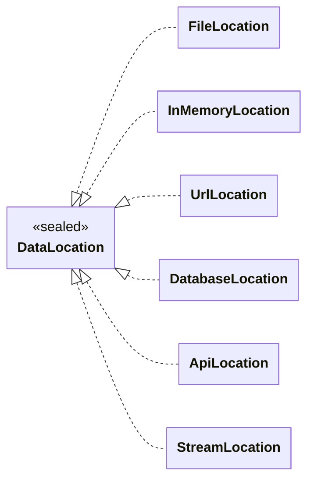

# carp.analytics: data locations

A [`DataLocation`](../carp.analytics.core/src/commonMain/kotlin/dk/cachet/carp/analytics/domain/data/DataLocation.kt) says where the data of a step input or output lives.
Every `InputDataSpec` and `OutputDataSpec` has one.
Core only describes the location. Reading and writing the data, and choosing where outputs go in a run, is the runtime's job: see [carp-dsp: bindings and output paths](https://github.com/carp-dk/carp-dsp/blob/main/docs/carp-dsp-bindings.md).

Back to [the domain model](carp-analytics-domain.md).

## Location types

`DataLocation` is sealed. Each type has a stable serial name, written as `__type` in JSON.

| Type | Serial name | Fields | Use for |
|---|---|---|---|
| `FileLocation` | `file` | `path`, `format` | A file. A blank path means the runtime chooses where it goes, which is the usual case for outputs. |
| `InMemoryLocation` | `in-memory` | `registryKey` | A value passed under a name, such as an environment variable. |
| `UrlLocation` | `url` | `url`, `format` | A file fetched over HTTP(S). |
| `DatabaseLocation` | `database` | `connectionString`, `table`, `format` | A database table. |
| `ApiLocation` | `api` | `endpoint`, `method` (default `GET`), `format` | An API endpoint. |
| `StreamLocation` | `stream` | `streamAddress`, `topicOrStream`, `format` | A stream, such as a Kafka topic. |

All types also have `metadata`, a free map of strings.
Runtimes use it to keep where a location came from; carp-dsp, for example, stores the YAML `source` type and, for step-linked inputs, the producer's `outputId`.

`format` is a [`FileFormat`](../carp.analytics.core/src/commonMain/kotlin/dk/cachet/carp/analytics/domain/data/FileFormat.kt), and defaults to `BINARY`.

## Inputs read from a location or a step

An input either reads from its own location, or names the step that produces it in `stepRef`.
For a step-linked input the location is only a placeholder (a `FileLocation` with a blank path): the runtime replaces it with the producer's output location when it plans the run.

## Validation

`InputDataSpec.validate()` and `OutputDataSpec.validate()` check that the location is complete:

| Location | Input | Output |
|---|---|---|
| `FileLocation` | Needs a path, unless `stepRef` is set. | Needs a format: `OutputDataSpec.format`, or a location format other than `BINARY`. |
| `InMemoryLocation` | Needs a registry key. | Same. |
| `UrlLocation` | Needs a URL. | Same. |
| `DatabaseLocation` | Needs a connection string and a table. | Same. |
| `ApiLocation` | Needs an endpoint. | Same. |
| `StreamLocation` | Needs an address and a topic or stream name. | Same. |

A `stepRef` that is set must not be blank.
Problems are returned as a `DataSpecValidationResult.Invalid` with one message each. See [validation](carp-analytics-validation.md) for the checks across a whole workflow.

## Adding a location type

Every runtime has to know how to read and write each kind of location, so a new type is added in core, not by extending `DataLocation` elsewhere.
Add the class to [`DataLocation.kt`](../carp.analytics.core/src/commonMain/kotlin/dk/cachet/carp/analytics/domain/data/DataLocation.kt) with a serial name, add its rules to `InputDataSpec.validate()` and `OutputDataSpec.validate()`, and then support it in each runtime.
