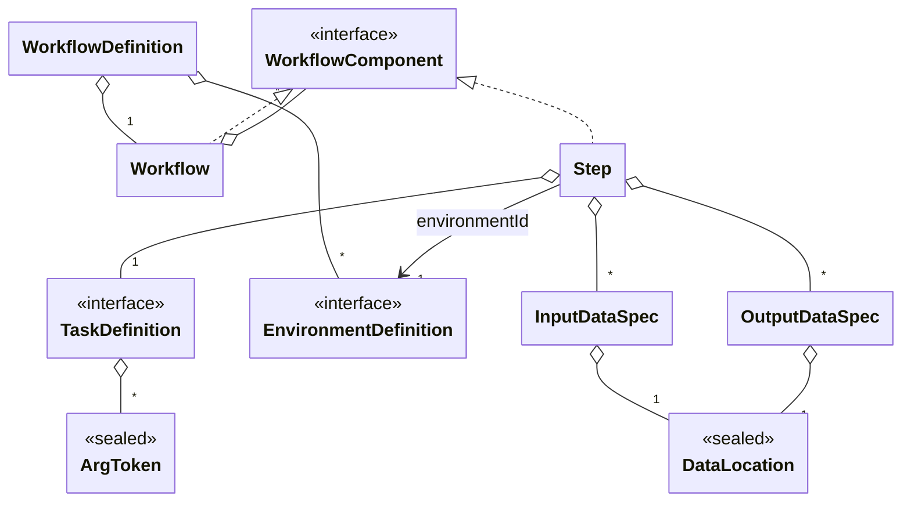
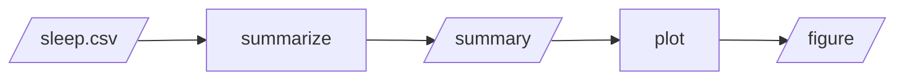
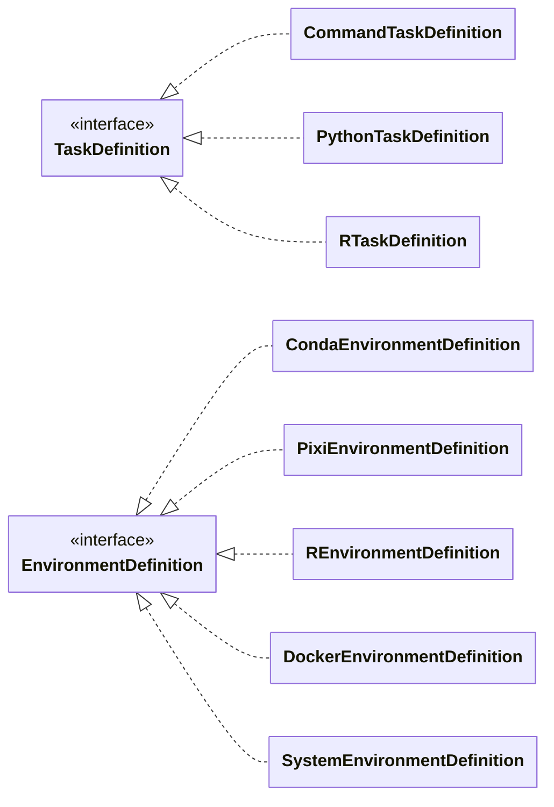

# carp.analytics: domain model

The domain model describes _what_ an analysis workflow does: which steps it runs, which code each step runs, in which environment, and which data flows between steps.
It does not say _how_ a workflow is run. Planning and running workflows is the job of a runtime such as [carp-dsp](https://github.com/carp-dk/carp-dsp).

Back to [carp.analytics](carp-analytics.md).

## Overview



A [`WorkflowDefinition`](../carp.analytics.core/src/commonMain/kotlin/dk/cachet/carp/analytics/domain/workflow/WorkflowDefinition.kt) is the unit the application services store and exchange.
It holds one [`Workflow`](../carp.analytics.core/src/commonMain/kotlin/dk/cachet/carp/analytics/domain/workflow/Workflow.kt) and the environments its steps run in.
Each [`Step`](../carp.analytics.core/src/commonMain/kotlin/dk/cachet/carp/analytics/domain/workflow/Step.kt) runs one task in one environment, reads its inputs and writes its outputs.

## Domain objects

Role follows [DDD](https://deviq.com/domain-driven-design/ddd-overview): the aggregate is stored and changed as a whole, entities have an identity, and value objects are compared by their values.
"Open" types can be extended outside core; "core only" types (sealed types and enums) only change in core (see [Extending domain objects](#extending-domain-objects)).

### Workflow (`domain/workflow`)

| Type | What it is | Role | Extend |
|---|---|---|---|
| [`WorkflowDefinition`](../carp.analytics.core/src/commonMain/kotlin/dk/cachet/carp/analytics/domain/workflow/WorkflowDefinition.kt) | A workflow and its environments, keyed by environment id | Aggregate | No |
| [`Workflow`](../carp.analytics.core/src/commonMain/kotlin/dk/cachet/carp/analytics/domain/workflow/Workflow.kt) | An ordered list of components; can be nested, since it is a component itself | Entity | No |
| [`WorkflowComponent`](../carp.analytics.core/src/commonMain/kotlin/dk/cachet/carp/analytics/domain/workflow/WorkflowComponent.kt) | Anything a workflow is made of: a step or a nested workflow | - | No |
| [`Step`](../carp.analytics.core/src/commonMain/kotlin/dk/cachet/carp/analytics/domain/workflow/Step.kt) | Runs one task in one environment, with its inputs and outputs | Entity | No |
| [`WorkflowMetadata`, `StepMetadata`, `Version`](../carp.analytics.core/src/commonMain/kotlin/dk/cachet/carp/analytics/domain/workflow/WorkflowMetadata.kt) | Id, name, description and version; `StepMetadata.descriptorId` links a step to its step library entry | Value object | No |
| [`StepsLock`](../carp.analytics.core/src/commonMain/kotlin/dk/cachet/carp/analytics/domain/workflow/StepsLock.kt) | Pins steps from the step library to an exact version and content hash | Value object | No |

### Tasks (`domain/tasks`)

| Type | What it is | Role | Extend |
|---|---|---|---|
| [`TaskDefinition`](../carp.analytics.core/src/commonMain/kotlin/dk/cachet/carp/analytics/domain/tasks/TaskDefinition.kt) | The code a step runs | Value object | Open |
| [`CommandTaskDefinition`](../carp.analytics.core/src/commonMain/kotlin/dk/cachet/carp/analytics/domain/tasks/CommandTaskDefinition.kt) | Any executable | Value object | - |
| [`PythonTaskDefinition`](../carp.analytics.core/src/commonMain/kotlin/dk/cachet/carp/analytics/domain/tasks/PythonTaskDefinition.kt) | A Python script or module ([`PythonEntryPoint`](../carp.analytics.core/src/commonMain/kotlin/dk/cachet/carp/analytics/domain/tasks/PythonEntryPoint.kt)) | Value object | - |
| [`RTaskDefinition`](../carp.analytics.core/src/commonMain/kotlin/dk/cachet/carp/analytics/domain/tasks/RTaskDefinition.kt) | An R script ([`REntryPoint`](../carp.analytics.core/src/commonMain/kotlin/dk/cachet/carp/analytics/domain/tasks/REntryPoint.kt)) | Value object | - |
| [`ArgToken`](../carp.analytics.core/src/commonMain/kotlin/dk/cachet/carp/analytics/domain/tasks/ArgToken.kt) | One argument: `Literal` as is; `InputRef`, `OutputRef` and `ParamRef` are replaced by a path or parameter when the step runs | Value object | Core only |

Arguments refer to inputs and outputs by id rather than by path, because paths are only known at run time.

### Data (`domain/data`)

| Type | What it is | Role | Extend |
|---|---|---|---|
| [`InputDataSpec`](../carp.analytics.core/src/commonMain/kotlin/dk/cachet/carp/analytics/domain/data/DataReference.kt) | Data a step reads; `stepRef` names the step that produces it, if any | Value object | No |
| [`OutputDataSpec`](../carp.analytics.core/src/commonMain/kotlin/dk/cachet/carp/analytics/domain/data/DataReference.kt) | Data a step writes | Value object | No |
| [`DataLocation`](../carp.analytics.core/src/commonMain/kotlin/dk/cachet/carp/analytics/domain/data/DataLocation.kt) | Where data lives: file, URL, database, API, stream or in-memory key | Value object | Core only |
| [`DataSchema`](../carp.analytics.core/src/commonMain/kotlin/dk/cachet/carp/analytics/domain/data/DataSchema.kt) | Optional format and columns of the data | Value object | No |
| [`FileFormat`](../carp.analytics.core/src/commonMain/kotlin/dk/cachet/carp/analytics/domain/data/FileFormat.kt) | Known file formats and their MIME types | Enum | Core only |

An input with `stepRef` reads the producer's output with the same `name`. These links decide the order in which steps run.
A blank file path means "let the runtime choose", which is the usual case for outputs.

### Environments (`domain/environment`)

| Type | What it is | Role | Extend |
|---|---|---|---|
| [`EnvironmentDefinition`](../carp.analytics.core/src/commonMain/kotlin/dk/cachet/carp/analytics/domain/environment/EnvironmentDefinition.kt) | Where a task runs and what it needs installed; steps refer to it by id | Entity | Open |
| [`CondaEnvironmentDefinition`](../carp.analytics.core/src/commonMain/kotlin/dk/cachet/carp/analytics/domain/environment/CondaEnvironmentDefinition.kt) | A Conda environment | Entity | - |
| [`PixiEnvironmentDefinition`](../carp.analytics.core/src/commonMain/kotlin/dk/cachet/carp/analytics/domain/environment/PixiEnvironmentDefinition.kt) | A Pixi environment, optionally from a lock file | Entity | - |
| [`REnvironmentDefinition`](../carp.analytics.core/src/commonMain/kotlin/dk/cachet/carp/analytics/domain/environment/REnvironmentDefinition.kt) | System R, optionally with an `renv` lock file | Entity | - |
| [`DockerEnvironmentDefinition`](../carp.analytics.core/src/commonMain/kotlin/dk/cachet/carp/analytics/domain/environment/DockerEnvironmentDefinition.kt) | A Docker image | Entity | - |
| [`SystemEnvironmentDefinition`](../carp.analytics.core/src/commonMain/kotlin/dk/cachet/carp/analytics/domain/environment/SystemEnvironmentDefinition.kt) | Whatever is installed on the host | Entity | - |

## Using the domain model

The example has two steps: `summarize` reads a CSV file, and `plot` reads the `summary` that `summarize` writes, by setting `stepRef = "summarize"` on its input.



### In Kotlin

Build the objects in code, and serialize them with [`CoreAnalyticsSerializer`](../carp.analytics.core/src/commonMain/kotlin/dk/cachet/carp/analytics/infrastructure/serialization/CoreAnalyticsSerializer.kt), which registers all polymorphic domain types.

```kotlin
// The environment both steps run in.
val pythonId = UUID.randomUUID()
val python = CondaEnvironmentDefinition( pythonId, "analysis", dependencies = listOf( "pandas==2.2.2" ) )

// Reads a CSV file and writes a summary.
val sleepId = UUID.randomUUID()
val summaryId = UUID.randomUUID()
val summarize = Step(
    metadata = StepMetadata( name = "summarize", id = UUID.randomUUID() ),
    inputs = listOf( InputDataSpec( sleepId, "sleep", location = FileLocation( "data/sleep.csv", FileFormat.CSV ) ) ),
    outputs = listOf( OutputDataSpec( summaryId, "summary", location = FileLocation( format = FileFormat.CSV ) ) ),
    task = PythonTaskDefinition(
        id = UUID.randomUUID(),
        name = "summarize",
        entryPoint = Script( "summarize.py" ),
        args = listOf( Literal( "--in" ), InputRef( sleepId ), Literal( "--out" ), OutputRef( summaryId ) )
    ),
    environmentId = pythonId
)

// Reads the "summary" output of the "summarize" step.
val plotInputId = UUID.randomUUID()
val figureId = UUID.randomUUID()
val plot = Step(
    metadata = StepMetadata( name = "plot", id = UUID.randomUUID() ),
    inputs = listOf( InputDataSpec( plotInputId, "summary", location = FileLocation(), stepRef = "summarize" ) ),
    outputs = listOf( OutputDataSpec( figureId, "figure", location = FileLocation( format = FileFormat.PNG ) ) ),
    task = PythonTaskDefinition(
        id = UUID.randomUUID(),
        name = "plot",
        entryPoint = Script( "plot.py" ),
        args = listOf( InputRef( plotInputId ), OutputRef( figureId ) )
    ),
    environmentId = pythonId
)

val workflow = Workflow( WorkflowMetadata( name = "Sleep summary", id = UUID.randomUUID(), version = Version( 1, 0 ) ) )
workflow.addComponents( listOf( summarize, plot ) )
val definition = WorkflowDefinition( workflow, mapOf( pythonId to python ) )

val json = CoreAnalyticsSerializer.json.encodeToString( WorkflowDefinition.serializer(), definition )
```

`Step.validate()` checks that each input and output is complete, for example that an external file input has a path and that an output has a format.
Checks across the whole workflow, such as a missing producer step or an unknown environment, are done by the workflow validators.

## Extending domain objects



`TaskDefinition` and `EnvironmentDefinition` are open, so new kinds of code and new kinds of environment can be added.
In core, adding one means:

1. Add an **immutable data class** implementing the interface. Workflows are stored and compared by value, and a result is only reproducible if its definition does not change.
2. Add `@Serializable` and a stable `@SerialName`. The name is written to stored workflows, so changing it later breaks them.
3. Register the class in a `SerializersModule`: in `CoreAnalyticsSerializer` for a built-in type, or in your own module that includes the core one:
   ```kotlin
   val module = SerializersModule {
       include( CoreAnalyticsSerializer.module )
       polymorphic( TaskDefinition::class ) { subclass( JuliaTaskDefinition::class ) }
   }
   ```
4. Add a serialization round-trip test.

This only describes the new type. To use it, the runtime must also read it from YAML, plan it and run it.
The full list of steps across core and carp-dsp is in [Adding a task or environment type](carp-analytics-extending.md).

`DataLocation`, `ArgToken`, `PythonEntryPoint` and `REntryPoint` are sealed, and `FileFormat` is an enum.
A new kind of these changes how every runtime reads a workflow, so they are added in core rather than by extending.

For more on serialization, check [the serialization documentation for CARP developers](serialization.md).
