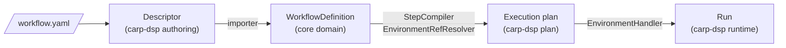

# Adding a task or environment type

A guide for developers who want workflows to run a new kind of code (a task type, for example Julia) or in a new kind of environment (for example a Python virtualenv).
A new type touches core and carp-dsp, so this page lists every change, in order.

Back to [the domain model](carp-analytics-domain.md).

## Where a type is used

1. **Core** defines the type, so services and clients can store and exchange it.
2. **carp-dsp authoring** reads it from YAML (importer) and writes it back (exporter).
3. **carp-dsp planning** turns a task into a command, and an environment into a resolved reference.
4. **carp-dsp runtime** sets the environment up, runs commands in it, and tears it down.

A type that is only added in core can be stored, but not written in YAML or run.

Paths in carp-dsp below are relative to `carp.dsp.core/src/<sourceSet>/kotlin/carp/dsp/core/`.

## Adding a task type

Running example: a `JuliaTaskDefinition` that runs `julia <script> <args>`.

### 1. Core: the domain type

- [ ] Add `JuliaTaskDefinition` in [`domain/tasks`](../carp.analytics.core/src/commonMain/kotlin/dk/cachet/carp/analytics/domain/tasks): an immutable `@Serializable` data class implementing [`TaskDefinition`](../carp.analytics.core/src/commonMain/kotlin/dk/cachet/carp/analytics/domain/tasks/TaskDefinition.kt), with a stable `@SerialName( "JuliaTaskDefinition" )`.
  Take arguments as `List<ArgToken>`, so inputs and outputs are referred to by id. Use [`RTaskDefinition`](../carp.analytics.core/src/commonMain/kotlin/dk/cachet/carp/analytics/domain/tasks/RTaskDefinition.kt) as the template.
- [ ] Register it under `polymorphic( TaskDefinition::class )` in [`CoreAnalyticsSerializer`](../carp.analytics.core/src/commonMain/kotlin/dk/cachet/carp/analytics/infrastructure/serialization/CoreAnalyticsSerializer.kt).
- [ ] Add a test in `commonTest/.../domain/tasks`: construction rules and a JSON round trip.
- [ ] Add a row to the Tasks table in [the domain model](carp-analytics-domain.md).

### 2. carp-dsp: YAML

- [ ] Add `JuliaTaskDescriptor` with `@SerialName( "julia" )` to the sealed `TaskDescriptor` (`commonMain: application/authoring/descriptor/TaskDescriptor.kt`). The serial name is the YAML `type:`. Arguments stay strings, so `input.0` and `output.0` work.
- [ ] Map it to the domain type in `TaskImporter.importTask` (`jvmMain: application/authoring/mapper/TaskImporter.kt`). Derive the id with `DeterministicUUID.v5( workflowNamespace, "task:julia:<name>" )` and import arguments with `inferAndImportArgument`, like the other branches.
- [ ] Map it back in `WorkflowDescriptorExporter.exportTask` (`commonMain: application/authoring/mapper/WorkflowDescriptorExporter.kt`).

### 3. carp-dsp: planning

- [ ] Add a branch to `StepCompiler` (`commonMain: application/plan/StepCompiler.kt`) that returns `CommandSpec( executable = "julia", args = <script> + expanded args )`. Expand arguments with `argTokenExpander`, as `compileR` does.
- [ ] Update the "only ... are supported" message in the same file.

The environment decides how the command is run (for example inside Conda), so a new task type needs no runtime change.

### 4. Tests and docs

- [ ] `TaskImporterTest`, `WorkflowDescriptorExporterTest` and `StepCompilerTest`: the new branch, and a YAML to plan round trip.
- [ ] Add a row to the Tasks table in carp-dsp's `docs/WORKFLOW_REFERENCE.md`.
- [ ] If the type is built in, add an example workflow.

## Adding an environment type

Running example: a `VenvEnvironmentDefinition` for a Python virtualenv.

### 1. Core: the domain type

- [ ] Add `VenvEnvironmentDefinition` in [`domain/environment`](../carp.analytics.core/src/commonMain/kotlin/dk/cachet/carp/analytics/domain/environment): an immutable `@Serializable` data class implementing [`EnvironmentDefinition`](../carp.analytics.core/src/commonMain/kotlin/dk/cachet/carp/analytics/domain/environment/EnvironmentDefinition.kt) (`id`, `name`, `dependencies`, `environmentVariables`), plus its own fields such as `pythonVersion`.
  Use [`PixiEnvironmentDefinition`](../carp.analytics.core/src/commonMain/kotlin/dk/cachet/carp/analytics/domain/environment/PixiEnvironmentDefinition.kt) as the template. If the environment can install from a lock file, add a `lockFile` field: it is what makes a run reproducible.
- [ ] Register it under `polymorphic( EnvironmentDefinition::class )` in [`CoreAnalyticsSerializer`](../carp.analytics.core/src/commonMain/kotlin/dk/cachet/carp/analytics/infrastructure/serialization/CoreAnalyticsSerializer.kt).
- [ ] Add it to `EnvironmentDefinitionTest` (round trip) and to the Environments table in [the domain model](carp-analytics-domain.md).

### 2. carp-dsp: YAML

Environments in YAML have a `kind` and a flat `spec` map of string lists, so there is no descriptor class to add.

- [ ] Add a `"venv"` branch to `EnvironmentImporter` (`jvmMain: application/authoring/mapper/EnvironmentImporter.kt`) that reads the spec keys.
- [ ] Add the reverse in `resolveKindAndSpec` in `WorkflowDescriptorExporter` (`commonMain: application/authoring/mapper/WorkflowDescriptorExporter.kt`). Without it the kind is exported as `unknown`.
- [ ] List the kind in the KDoc of `EnvironmentDescriptor` (`commonMain: application/authoring/descriptor/WorkflowDescriptor.kt`).

### 3. carp-dsp: planning

- [ ] Add `VenvEnvironmentRef` to the sealed `EnvironmentRef` (`commonMain: application/plan/EnvironmentRef.kt`). It holds what the runtime needs, resolved from the definition.
- [ ] Map definition to ref in `EnvironmentRefResolver` (`commonMain: application/environment/EnvironmentRefResolver.kt`). Unmapped types resolve to `null` and cannot run.

### 4. carp-dsp: runtime

- [ ] Add `VenvEnvironmentHandler` (`jvmMain: infrastructure/execution/handlers/`) implementing `EnvironmentHandler`:
  - `canHandle`: true for `VenvEnvironmentRef`.
  - `setup`: create the environment and install dependencies; reuse an existing one through `EnvironmentStore`, as the Pixi and R handlers do.
  - `generateExecutionCommand`: wrap a command so it runs inside the environment.
  - `validate` and `teardown`.
- [ ] Register it in `EnvironmentHandlerRegistry` (`jvmMain: infrastructure/execution/EnvironmentHandlerRegistry.kt`).
- [ ] If it has a lock file, add it to `lockFilesOf` in `WorkflowExecutor` (`jvmMain: application/run/WorkflowExecutor.kt`), so the lock file is copied into the run bundle.

### 5. Tests and docs

- [ ] `EnvironmentImporterTest`, `WorkflowDescriptorExporterTest`, `EnvironmentRefResolverTest`, `EnvironmentHandlerRegistryTest` and a `VenvEnvironmentHandlerTest`.
- [ ] An integration test that runs a one-step workflow in the new environment, like `SingleStepPythonPixiTest`.
- [ ] Add a row to the Environments table in carp-dsp's `docs/WORKFLOW_REFERENCE.md`.

