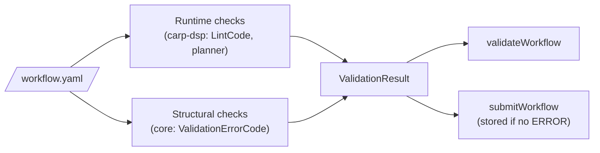

# carp.analytics: validation

Validation finds problems in a workflow before anything runs, so a researcher can fix them while writing it.
Core checks the structure of a workflow, which is the same for any runtime.
A runtime adds checks of its own, for example on its YAML format or on how environments are pinned.
Both report the same `ValidationIssue`s, in one `ValidationResult`.

Back to [carp.analytics](carp-analytics.md).



## Types

| Type | What it is |
|---|---|
| [`ValidationResult`](../carp.analytics.core/src/commonMain/kotlin/dk/cachet/carp/analytics/domain/validation/ValidationResult.kt) | All issues found. `isValid` is true when no issue is an `ERROR`. |
| [`ValidationIssue`](../carp.analytics.core/src/commonMain/kotlin/dk/cachet/carp/analytics/domain/validation/ValidationIssue.kt) | One problem: `severity`, `code`, `message`, and optionally `path` (where in the workflow) and `subjectId` (the step, input or output it is about). |
| [`ValidationSeverity`](../carp.analytics.core/src/commonMain/kotlin/dk/cachet/carp/analytics/domain/validation/ValidationSeverity.kt) | `ERROR` stops the workflow from being stored or run. `WARNING` and `INFO` are reported but do not. |
| [`ValidationErrorCode`](../carp.analytics.core/src/commonMain/kotlin/dk/cachet/carp/analytics/domain/validation/ValidationErrorCode.kt) | The codes of the structural checks in core. |
| `SubmitResult` | What `submitWorkflow` returns: the stored workflow's metadata, or null when there were errors, and the `ValidationResult`. |

`Step.validate()` and `InputDataSpec.validate()` / `OutputDataSpec.validate()` check a single object and return `StepValidationResult` and `DataSpecValidationResult`.
They answer "is this object complete?", while `ValidationResult` answers "can this workflow run?".

## Structural checks

All structural issues are `ERROR`s.

| Code | Problem | Checked by |
|---|---|---|
| `WORKFLOW_STEP_ID_DUPLICATE` | Two steps have the same id. | [`WorkflowValidator`](../carp.analytics.core/src/commonMain/kotlin/dk/cachet/carp/analytics/domain/validation/WorkflowValidator.kt) |
| `WORKFLOW_MISSING_ENVIRONMENT` | A step runs in an environment the workflow does not define. | `WorkflowValidator` |
| `WORKFLOW_DEP_REFERENCE_MISSING` | A step depends on a step that does not exist. | `WorkflowValidator` |
| `WORKFLOW_DEP_CYCLE_DETECTED` | Steps depend on each other in a cycle. | `WorkflowValidator` |
| `STEP_INPUT_PORT_DUPLICATE_ID` | Two inputs of a step have the same id. | [`StepValidator`](../carp.analytics.core/src/commonMain/kotlin/dk/cachet/carp/analytics/domain/validation/StepValidator.kt) |
| `STEP_OUTPUT_PORT_DUPLICATE_ID` | Two outputs of a step have the same id. | `StepValidator` |
| `STEP_INPUT_REQUIRED_MISSING` | A required input is missing. | `StepValidator` |
| `STEP_SPEC_TYPE_MISSING` | An input or output has no type, where types are required. | `StepValidator` |

## Using the validators

`WorkflowValidator` and `StepValidator` are generic: a `Config` tells them how to read ids, dependencies and environments from your type.
The same checks can then run on the domain model, on a runtime's own authoring format, or on a client's form state.
Checks whose accessors are not given are skipped.

The example validates a `WorkflowDefinition`. A step depends on the steps its inputs read from (`stepRef`).

```kotlin
val config = WorkflowValidator.Config<WorkflowDefinition, Step>(
    workflowId = { it.workflow.metadata.name },
    steps = { it.workflow.getComponents().filterIsInstance<Step>() },
    stepId = { it.metadata.name },
    dependencies = { step -> step.inputs.mapNotNull { it.stepRef } },
    environmentIds = { d -> d.environments.keys.map { it.toString() }.toSet() },
    stepEnvironmentId = { it.environmentId.toString() }
)

val result = WorkflowValidator.validate( definition, config )
if ( !result.isValid )
{
    result.issues
        .filter { it.severity == ValidationSeverity.ERROR }
        .forEach { println( "${it.code} at ${it.path}: ${it.message}" ) }
}
```

Steps are checked one at a time:

```kotlin
val stepConfig = StepValidator.Config<Step>(
    stepId = { it.metadata.name },
    inputIds = { step -> step.inputs.map { it.name } },
    outputIds = { step -> step.outputs.map { it.name } }
)
val stepResult = StepValidator.validate( step, stepConfig )
```

## Codes from a runtime

`ValidationIssue.code` is a string, so a runtime can report checks core does not know about without changing core.
Structural issues use the name of a `ValidationErrorCode`, for example `WORKFLOW_STEP_ID_DUPLICATE`.
A runtime defines its own codes:

- Write codes in upper snake case, like the core codes, and do not reuse a core code for a different problem.
- Choose the severity per issue: `ERROR` only when the workflow cannot run, `WARNING` when it can but the result may not be what the researcher expects.
- Combine the runtime's issues and the structural issues into one `ValidationResult`.

carp-dsp, for example, reports its checks as `LintCode`s: unresolved `uses:` references, unknown environment kinds, malformed UUIDs, environments that pin no versions, unattributed external inputs, and optional style rules ([workflow reference](https://github.com/carp-dk/carp-dsp/blob/main/docs/WORKFLOW_REFERENCE.md)).

Clients should not depend on the full list of codes. Show the `message`, sort or filter by `severity`, and use `path` and `subjectId` to point at the part of the workflow to fix.

## In the application services

- `WorkflowService.validateWorkflow` returns the `ValidationResult` without storing anything. Call it while the researcher edits.
- `WorkflowService.submitWorkflow` stores the workflow only when the result has no errors, and returns a `SubmitResult` with the warnings either way.
