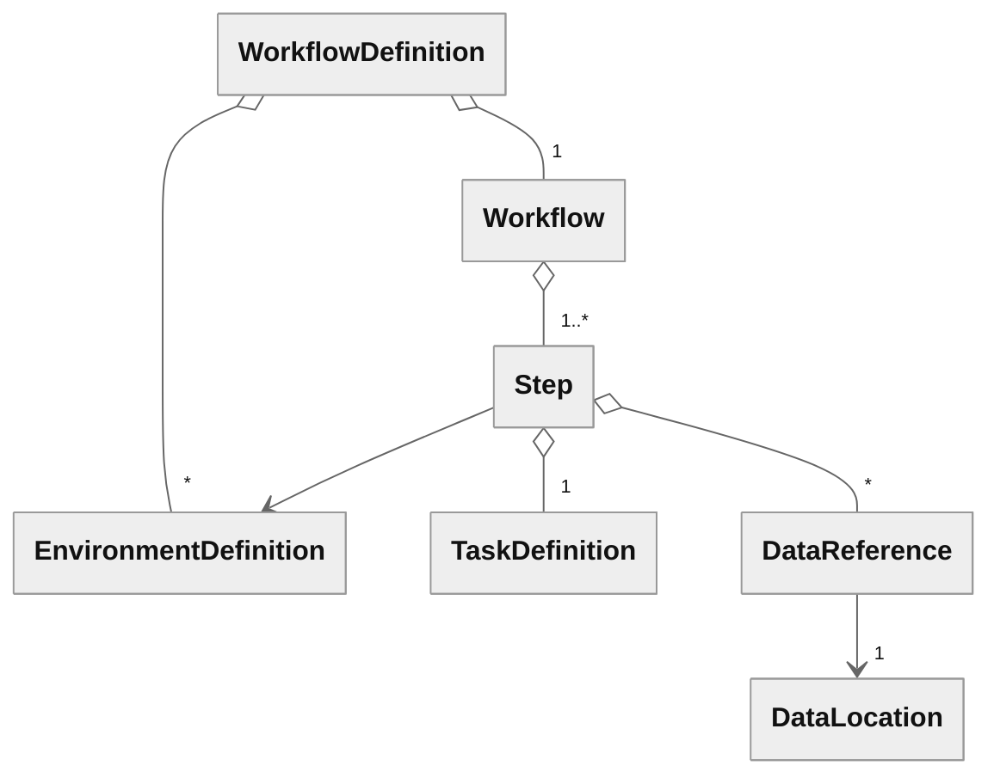
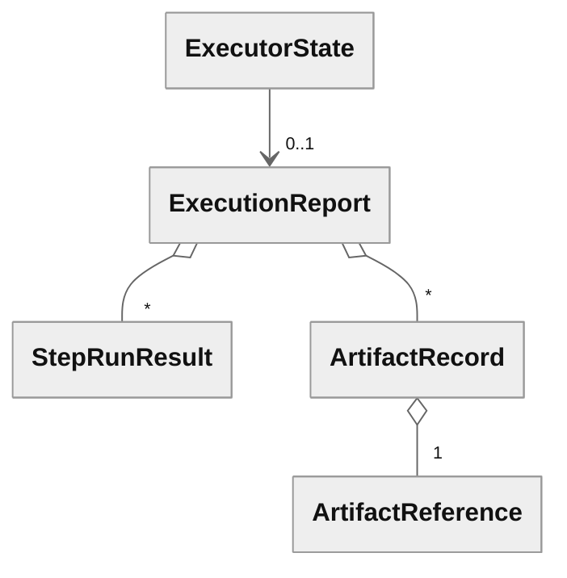

# carp.analytics  

Runs analysis workflows over collected study data, and keeps the results.
Each result records which data, code and environment produced it, so its full provenance is known.

## Workflows

A [`Workflow`](../carp.analytics.core/src/commonMain/kotlin/dk/cachet/carp/analytics/domain/workflow/Workflow.kt) belongs to a study and is identified by its [`WorkflowMetadata`](../carp.analytics.core/src/commonMain/kotlin/dk/cachet/carp/analytics/domain/workflow/WorkflowMetadata.kt): an id, a name and a version.
It is made up of [`Step`](../carp.analytics.core/src/commonMain/kotlin/dk/cachet/carp/analytics/domain/workflow/Step.kt)s, each of which runs one [`TaskDefinition`](../carp.analytics.core/src/commonMain/kotlin/dk/cachet/carp/analytics/domain/tasks/TaskDefinition.kt) (Python, R or a command) in an [`EnvironmentDefinition`](../carp.analytics.core/src/commonMain/kotlin/dk/cachet/carp/analytics/domain/environment/EnvironmentDefinition.kt).
Steps declare their inputs and outputs as [`DataReference`](../carp.analytics.core/src/commonMain/kotlin/dk/cachet/carp/analytics/domain/data/DataReference.kt)s.
An input reads from a [`DataLocation`](../carp.analytics.core/src/commonMain/kotlin/dk/cachet/carp/analytics/domain/data/DataLocation.kt), or from the output of an earlier step, which determines the order in which steps run.
The services exchange a workflow as a [`WorkflowDefinition`](../carp.analytics.core/src/commonMain/kotlin/dk/cachet/carp/analytics/domain/workflow/WorkflowDefinition.kt): the workflow together with the environments its steps run in.
Steps taken from a shared step library are pinned to exact versions in a [`StepsLock`](../carp.analytics.core/src/commonMain/kotlin/dk/cachet/carp/analytics/domain/workflow/StepsLock.kt).

## Runs and results

Running a workflow starts an execution, whose progress is tracked by [`ExecutorState`](../carp.analytics.core/src/commonMain/kotlin/dk/cachet/carp/analytics/application/execution/ExecutorState.kt).
When it ends, an [`ExecutionReport`](../carp.analytics.core/src/commonMain/kotlin/dk/cachet/carp/analytics/application/execution/ExecutionReport.kt) holds the result of each step and an [`ArtifactRecord`](../carp.analytics.core/src/commonMain/kotlin/dk/cachet/carp/analytics/application/data/ArtifactRecord.kt) for each output produced.
Artifacts are scoped to the whole cohort or to one participant, and are fetched by [`ArtifactReference`](../carp.analytics.core/src/commonMain/kotlin/dk/cachet/carp/analytics/application/data/ArtifactReference.kt) rather than through the application services.
See [runs and artifacts](carp-analytics-runs.md) for the run lifecycle, cancellation and participant results.

## Application services

The _'Require'_ and _'Grant'_ column lists claim-based authorization recommendations for implementing infrastructures.
Respectively, the required claims and claims to grant upon a successful request.

### [`WorkflowService`](../carp.analytics.core/src/commonMain/kotlin/dk/cachet/carp/analytics/application/WorkflowService.kt)

Validate, store and retrieve the analysis workflows of a study.

| Endpoint | Description | Require | Grant |
| --- | --- | --- | --- |
| `validateWorkflow` | Check a workflow written in YAML without storing it, and return the issues found. | manage study: `studyId` | |
| `submitWorkflow` | Validate a workflow written in YAML, and store it when it has no errors. | manage study: `studyId` | |
| `createWorkflow` | Store an already parsed workflow. | manage study: `studyId` | |
| `updateWorkflow` | Store a new version of an existing workflow. | manage study: `studyId` | |
| `getWorkflow` | Get a workflow, at its latest or a specific version. | manage study: `studyId` | |
| `listWorkflows` | Get the metadata of all workflows in a study. | manage study: `studyId` | |
| `listWorkflowVersions` | Get the metadata of all stored versions of a workflow. | manage study: `studyId` | |
| `getStepsLock` | Get the step library versions a workflow version uses. | manage study: `studyId` | |
| `deleteWorkflow` | Remove a workflow and all its versions. Past runs and their results are kept. | manage study: `studyId` | |

### [`ExecutionService`](../carp.analytics.core/src/commonMain/kotlin/dk/cachet/carp/analytics/application/ExecutionService.kt)

Start, follow and cancel workflow runs, and retrieve their results.

| Endpoint | Description | Require | Grant |
| --- | --- | --- | --- |
| `executeWorkflow` | Start a run of a stored workflow, or return the run already active for it. | manage study: `studyId` | |
| `executeWorkflowFromDefinition` | Start a run of a workflow without storing it. | manage study: `studyId` | |
| `cancelExecution` | Stop a run. Steps that already finished keep their outputs. | manage study: `studyId` | |
| `getExecutionState` | Get the current state of a run. | manage study: `studyId` | |
| `getExecutionResult` | Get the report of a run that has ended. | manage study: `studyId` | |
| `findExecutions` | Find runs in a study, newest first, optionally for one workflow, within a time range, or up to a limit. | manage study: `studyId` | |
| `getParticipantResults` | Get the participant-scoped artifacts produced for a study deployment, optionally only those produced after a given time. | in deployment: `studyDeploymentId` | |
