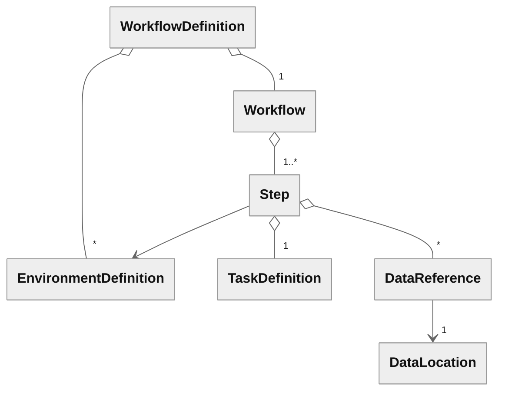

# carp.analytics  

Runs analysis workflows over collected study data, and keeps the results.
Each result records which data, code and environment produced it, so its full provenance is known.

## Workflows

A [`Workflow`](../carp.analytics.core/src/commonMain/kotlin/dk/cachet/carp/analytics/domain/workflow/Workflow.kt) belongs to a study and is identified by its [`WorkflowMetadata`](../carp.analytics.core/src/commonMain/kotlin/dk/cachet/carp/analytics/domain/workflow/WorkflowMetadata.kt): an id, a name and a version.
It is made up of [`Step`](../carp.analytics.core/src/commonMain/kotlin/dk/cachet/carp/analytics/domain/workflow/Step.kt)s, each of which runs one [`TaskDefinition`](../carp.analytics.core/src/commonMain/kotlin/dk/cachet/carp/analytics/domain/tasks/TaskDefinition.kt) (Python, R or a command) in an [`EnvironmentDefinition`](../carp.analytics.core/src/commonMain/kotlin/dk/cachet/carp/analytics/domain/environment/EnvironmentDefinition.kt).
Steps declare their inputs and outputs as [`DataReference`](../carp.analytics.core/src/commonMain/kotlin/dk/cachet/carp/analytics/domain/data/DataReference.kt)s.
An input reads from a [`DataLocation`](../carp.analytics.core/src/commonMain/kotlin/dk/cachet/carp/analytics/domain/data/DataLocation.kt), or from the output of an earlier step, which determines the order in which steps run.
The services exchange a workflow as a [`WorkflowDefinition`](../carp.analytics.core/src/commonMain/kotlin/dk/cachet/carp/analytics/domain/workflow/WorkflowDefinition.kt): the workflow together with the environments its steps run in.
Steps taken from a shared step library are pinned to exact versions in a [`StepsLock`](../carp.analytics.core/src/commonMain/kotlin/dk/cachet/carp/analytics/domain/workflow/StepsLock.kt).
See [the domain model](carp-analytics-domain.md) for each type, how to use it and how to extend it.

